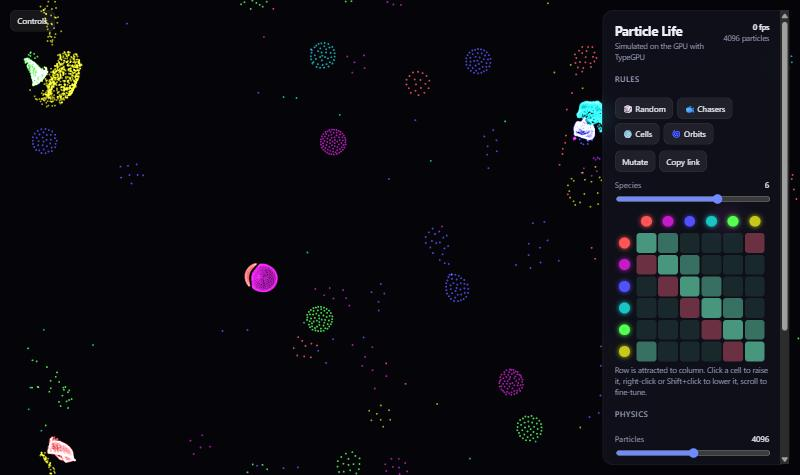
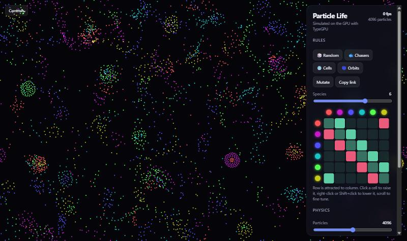

# Particle Life on the GPU

Thousands of particles, a handful of attraction rules, and the result looks
alive. The simulation runs entirely on the GPU through **WebGPU**. Every shader,
compute and render alike, is written in plain TypeScript with
[**TypeGPU**](https://docs.swmansion.com/TypeGPU/).

<p align="center">
  
  
</p>

## What it does

- Up to **16,384 particles** of 2–8 species. Every frame, each particle feels
  every other particle within a radius (O(n²) pairs, computed in parallel).
- An **N×N attraction matrix** decides whether species *A* is drawn to or
  pushed away from species *B*. The matrix is not symmetric, so A can chase B
  while B flees, and that is what produces the moving "creatures".
- **Edit the rules live.** Click the matrix cells, try presets (Chasers, Cells,
  Orbits) or randomise and mutate them.
- **Shareable universes.** The rules are encoded in the URL hash, one
  character per cell, so *Copy link* reproduces exactly what you see.
- **Touch the simulation.** Drag to push particles away, Shift- or right-drag
  to pull them in. It works with a mouse and on phones.
- **Fills any screen.** The world is a torus whose aspect ratio follows the
  viewport, so there are no letterbox bars on phones or ultrawide monitors.

## How TypeGPU is used

| Piece | Where |
| --- | --- |
| Typed data schemas (`d.struct`, `d.arrayOf`) for particles, params and the matrix | [`src/gpu/simulation.ts`](src/gpu/simulation.ts) |
| Compute pipeline (`createGuardedComputePipeline`), one thread per particle | `step` in `simulation.ts` |
| Ping-pong storage buffers via `tgpu.bindGroupLayout` and two bind groups | `computeLayout` / `computeGroups` |
| Instanced render pipeline with inline `'use gpu'` vertex and fragment functions | `draw` in `simulation.ts` |
| Shared physics written once, compiled to WGSL **and** unit-tested on the CPU | [`src/sim/physics.ts`](src/sim/physics.ts) |

The force curve, the torus wrapping and the colour palette are ordinary
TypeScript functions marked with `'use gpu'`. At build time,
[`unplugin-typegpu`](https://docs.swmansion.com/TypeGPU/tooling/unplugin-typegpu/)
turns them into WGSL for the compute and render pipelines. They are still
regular JS functions too, so [`physics.test.ts`](src/sim/physics.test.ts)
calls them directly in Vitest. **The tests check the same code that runs on the
GPU.** One finding from writing those tests: TypeGPU's CPU `round()` does not
support vectors yet, so the torus wrapping uses `fract()`, which works on both
sides.

### The physics in one paragraph

For every pair closer than `rMax`, the force follows a two-part curve. At very
short range everything repels, so particles never collapse into a point.
Further out, the force is a triangle that peaks at the matrix value for that
pair of species. Forces add up into an acceleration. Velocity decays with a
friction half-life, and positions wrap around the edges of the torus.

## Running locally

Requires a browser with WebGPU (recent Chrome, Edge or Safari).

```bash
npm install
npm run dev        # http://localhost:5173
```

```bash
npm test           # Vitest: physics + rules (runs the 'use gpu' functions on the CPU)
npm run typecheck  # tsc --noEmit
npm run build      # production build in dist/
```

## Project structure

```
src/
  gpu/simulation.ts   TypeGPU resources, compute + render pipelines
  sim/physics.ts      'use gpu' functions shared by GPU and tests
  sim/rules.ts        seeded PRNG, presets, mutation, URL encoding
  main.ts             UI, matrix editor, pointer input, frame loop
  style.css
```

## Ideas for later

- Spatial binning, so each particle only checks nearby cells instead of all
  pairs. This would make 100k+ particles possible.
- Recording a clip of the simulation with `MediaRecorder`.

## License

MIT
